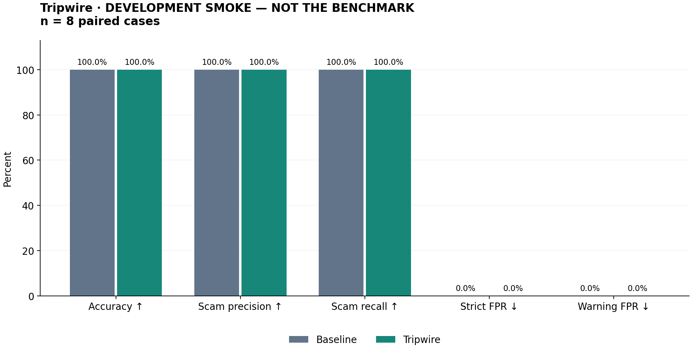

# Tripwire evaluation results

**DEVELOPMENT SMOKE — NOT THE BENCHMARK.**

These 8 separate development messages validate integration only. They do not measure real-world scam detection or establish an advantage over the baseline.
The frozen 120-case benchmark has not been run. Droid and detonation are absent from this checks ablation.

Run: `dev-checks-v2`. Code commit: `abc3cb202344b34c9a89ce42949db06be3ee05b3`. Mode: `checks`.
Created: 2026-10-17T17:58:49.159283+00:00. Baseline model: `anthropic/claude-haiku-5-5`.
Investigator model: its pinned source configuration (may differ from baseline; this is a system comparison).

| Metric | Baseline | Tripwire |
|---|---:|---:|
| Cases | 8 | 8 |
| Exact accuracy (failures incorrect) | 100.0% | 100.0% |
| Scam precision | 100.0% | 100.0% |
| Scam recall | 100.0% | 100.0% |
| Strict false-positive rate | 0.0% | 0.0% |
| Warning false-positive rate | 0.0% | 0.0% |
| Median latency (seconds) | 1.570 | 2.502 |
| Inference failures / fallbacks | 0 | 0 |
| Failed evidence checks | 0 | 0 |
| Mean USD / case | unknown | unknown |

Exact accuracy requires the correct three-class label and a successful call. Scam precision/recall treat only `scam` as positive. Strict FPR is scam predictions / gold-safe cases; warning FPR includes suspicious predictions. Missing denominators are N/A. Latency includes process startup and failures.
Cost is **unknown**: the investigator does not expose complete billed token, Droid, and sandbox usage. Baseline token counts, when available, are retained in raw results; no price assumptions are substituted.

## Baseline confusion matrix

Gold rows; predicted columns, including fallbacks.

| Gold | safe | suspicious | scam |
|---|---:|---:|---:|
| safe | 4 | 0 | 0 |
| suspicious | 0 | 0 | 0 |
| scam | 0 | 0 | 4 |

## Tripwire confusion matrix

Gold rows; predicted columns, including fallbacks.

| Gold | safe | suspicious | scam |
|---|---:|---:|---:|
| safe | 4 | 0 | 0 |
| suspicious | 0 | 0 | 0 |
| scam | 0 | 0 | 4 |

## Source strata

| Source | System | N | Accuracy | Warning FPR |
|---|---|---:|---:|---:|
| development | baseline | 8 | 100.0% | 0.0% |
| development | tripwire | 8 | 100.0% | 0.0% |

## Evidence review

Author spot-check: 6/10 evidence items fully supported under a strict text/check-grounding rubric. This is an unblinded agent review, not independent expert validation.
6 fully supported, 3 partially supported, 1 unsupported. The fake-check message was mislabeled as a rental pattern with mismatched verification advice. Two findings were truncated mid-word. Three findings include external or unobserved claims beyond supplied checks. Correct top-level labels therefore do not establish evidence quality.
See the run's `evidence_review.json` for per-item support and limitations.

## Chalk Evaluations

Evaluation ID: `cmvcpbq5z01uq013e1vpjshu2`. Run ID: `70688701-9271-407c-8e15-79f4ff336f64`.
Status: `EvaluationRunStatus.SUCCEEDED`. Remote row/score verification: **True**.
Systems ran locally; saved predictions were uploaded as a Chalk dataset. A deployed replay task returns each prediction, and eight remote SQL scorers measure correctness and confusion counts. Every returned output and score is checked against local calculations; task/scorer row errors invalidate verification even if the run status says SUCCEEDED.

## Reproduce and limitations

```bash
../HackHarvard/.venv/bin/python -m pytest tests evals -q
../HackHarvard/.venv/bin/python -m evals.report evals/runs/dev-checks-v2 --out evals
```

See [DATASET.md](DATASET.md) for provenance, licenses, class policy, and historical-label limitations. Synthetic and selected cases are not representative of incoming scam prevalence. This benchmark does not evaluate Scamio, Norton, or another commercial system. Baseline and investigator have different prompts and potentially different models, so changes cannot be attributed to tools alone.


