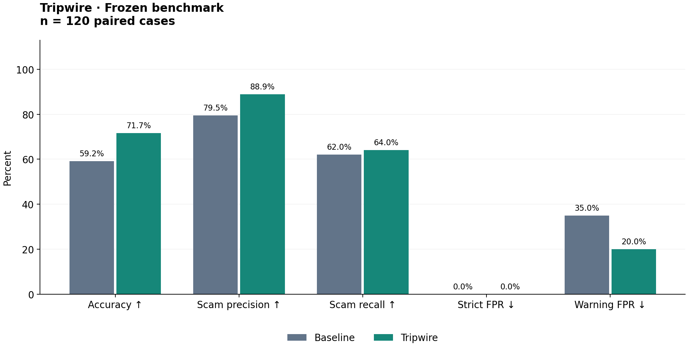

# Tripwire evaluation results

**Frozen benchmark.**

Run: `full-v2`. Code commit: `f754dc895e158cd404034d5c0e517f5ea75f57b5`. Mode: `full`.
Created: 2026-10-17T20:46:15.708851+00:00. Baseline model: `anthropic/claude-haiku-5-5`.
Investigator model: its pinned source configuration (may differ from baseline; this is a system comparison).

| Metric | Baseline | Tripwire |
|---|---:|---:|
| Cases | 120 | 120 |
| Exact accuracy (failures incorrect) | 59.2% | 71.7% |
| Accuracy among successful calls | 76.3% | 71.7% |
| Scam precision | 79.5% | 88.9% |
| Scam recall | 62.0% | 64.0% |
| Strict false-positive rate | 0.0% | 0.0% |
| Warning false-positive rate | 35.0% | 20.0% |
| Median latency (seconds) | 1.388 | 21.866 |
| Inference failures / fallbacks | 27 | 0 |
| Failed evidence checks | 0 | 1 |
| Mean USD / case | unknown | unknown |

Baseline failure types: `gateway_incomplete_response` (27).

Recorded runtime configuration: verdict `anthropic/claude-sonnet-5-5`, Droid `claude-haiku-5-5`. Package versions and interpreter are preserved in `runtime_info.json`.

Droid runtime coverage: **76/120 confirmed successful sessions**; 12 cases report written analysis scripts. Failed or timed-out sessions are not counted as successful tool use, even when a fallback verdict is correct.

Sandbox coverage: **3/120 cases requested detonation**; 3 returned screenshot paths; 2 reported successful page capture. Selected IDs: `synthetic-039`, `url-154131`, `url-69188`.
All other cases use the investigation path with sandbox detonation disabled. Droid may be skipped by the production fast path when no analyzable artifacts or warning signs exist. A returned screenshot path does not by itself establish image quality or successful phone delivery.
Offline screenshot audit: 1 near-uniform images and 0 missing/undecodable images among 3 sandbox requests. Saved images and dimensions are in `screenshot_audit.json`. This audit does not establish successful iMessage attachment delivery.
The three sandbox cases yielded a DNS failure with a uniform blank image, a Cuttly 404 page, and a FedEx access-denied page (HTTP 200). No live phishing form was captured in this benchmark; these cases demonstrate sandbox execution and limitations, not successful phishing-page detection.

Exact accuracy requires the correct three-class label and a successful call. Scam precision/recall treat only `scam` as positive. Strict FPR is scam predictions / gold-safe cases; warning FPR includes suspicious predictions. Missing denominators are N/A. Latency includes process startup and failures.
Cost is **unknown**: the investigator does not expose complete billed token, Droid, and sandbox usage. Baseline token counts, when available, are retained in raw results; no price assumptions are substituted.

## Paired outcomes and uncertainty

Both systems correct: 65; baseline alone correct: 6; Tripwire alone correct: 21; neither correct: 28.

| System | Accuracy: 95% Wilson interval | Strict FPR: 95% Wilson interval |
|---|---:|---:|
| baseline | 50.2%–67.5% | 0.0%–6.0% |
| tripwire | 63.0%–79.0% | 0.0%–6.0% |

Intervals describe binomial sampling uncertainty only. This selected convenience set is not a random sample of incoming messages; the intervals do not account for selection bias, label uncertainty, shared templates, or temporal drift. Zero observed false positives does not imply zero risk.

## Baseline confusion matrix

Gold rows; predicted columns, including fallbacks.

| Gold | safe | suspicious | scam |
|---|---:|---:|---:|
| safe | 39 | 21 | 0 |
| suspicious | 0 | 2 | 8 |
| scam | 0 | 19 | 31 |

## Tripwire confusion matrix

Gold rows; predicted columns, including fallbacks.

| Gold | safe | suspicious | scam |
|---|---:|---:|---:|
| safe | 48 | 12 | 0 |
| suspicious | 0 | 6 | 4 |
| scam | 0 | 18 | 32 |

## Source strata

| Source | System | N | Accuracy | Warning FPR |
|---|---|---:|---:|---:|
| tripwire_synthetic | baseline | 40 | 100.0% | 0.0% |
| tripwire_synthetic | tripwire | 40 | 92.5% | 15.0% |
| uci_phiusiil | baseline | 40 | 10.0% | 85.0% |
| uci_phiusiil | tripwire | 40 | 37.5% | 40.0% |
| uci_sms | baseline | 40 | 67.5% | 20.0% |
| uci_sms | tripwire | 40 | 85.0% | 5.0% |

## Evidence review

Author spot-check: 21/32 evidence items fully supported under a strict text/check-grounding rubric. This is an unblinded agent review, not independent expert validation.
Reviewed all 32 evidence items from seven selected cases: 21 supported, 10 partial, 1 unsupported. Main issues: unsupported .ru pricing/prevalence claim; assumed lack of prize entry; external/general claims presented as observed facts; static HTML checks overstated. Historical benign URL no longer resolves and historical phishing shortener returns 404. Failed-check statements can be supported statements of failure, not successful investigation. Registry claims were checked for consistency with saved results only; no site was fetched locally.
See the run's `evidence_review.json` for per-item support and limitations.

## Chalk Evaluations

Pending; no remote evaluation success is claimed.

## Reproduce and limitations

```bash
../HackHarvard/.venv/bin/python -m pytest tests evals -q
../HackHarvard/.venv/bin/python -m evals.report evals/runs/full-v2 --out evals/runs/full-v2/report
```

See [DATASET.md](DATASET.md) for provenance, licenses, class policy, and historical-label limitations. Synthetic and selected cases are not representative of incoming scam prevalence. This benchmark does not evaluate Scamio, Norton, or another commercial system. Baseline and investigator have different prompts and potentially different models, so changes cannot be attributed to tools alone.


